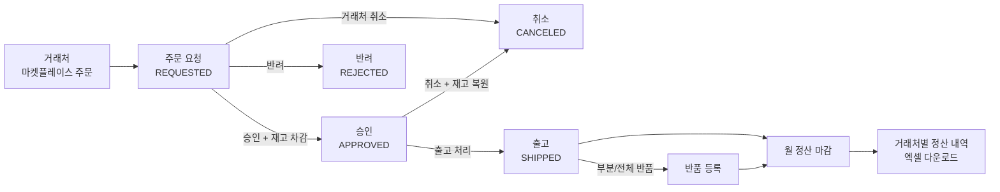
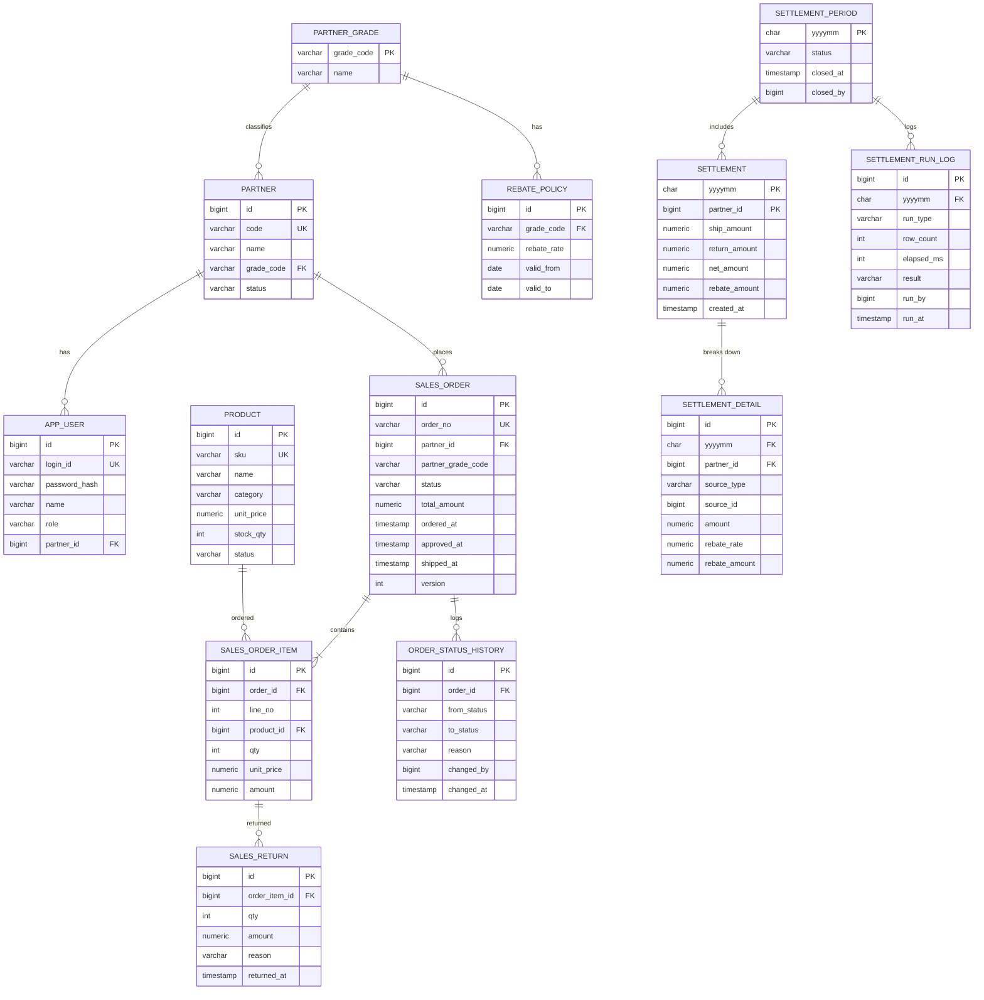

# mini-erp 설계 문서

B2B IT 유통사를 가정한 **주문·출고·월 정산 미니 ERP**입니다.
거래처가 마켓플레이스에서 주문하면 내부 담당자가 승인·출고하고, 월말에 거래처 등급별 리베이트를 계산해 정산을 마감하는 흐름을 구현합니다.

---

## 1. 만드는 이유와 목표

| 목표 | 구현 포인트 |
|---|---|
| React로 업무 화면 개발 | 주문·정산 그리드, 검색 조건, 입력 폼, 권한별 화면 분리 |
| PL/SQL(PostgreSQL) 활용 | 월 정산 마감을 PL/pgSQL 프로시저로 구현 |
| 기간계 업무 규칙 이해 | 마감월 수정 불가, 정책 변경 이력 반영, 반품 차감 처리 |
| 성능과 정합성 검증 | 10만 건 기준 마감 시간 측정, 동시 승인 시 재고 정합성 테스트 |

범위 밖: 회계 전표, 세금계산서, 결제 연동, 배송 추적

---

## 2. 업무 흐름



### 주문 상태 전이

| 현재 상태 | 가능한 다음 상태 | 처리 주체 | 부가 처리 |
|---|---|---|---|
| REQUESTED | APPROVED | 관리자 | 재고 차감 (부족하면 승인 실패) |
| REQUESTED | REJECTED | 관리자 | 반려 사유 필수 |
| REQUESTED | CANCELED | 거래처 | - |
| APPROVED | CANCELED | 관리자 | 재고 복원 |
| APPROVED | SHIPPED | 관리자 | 출고일시 기록 (정산 기준일) |

상태가 바뀔 때마다 `order_status_history`에 변경 전·후 상태, 처리자, 사유를 남깁니다.

---

## 3. 업무 규칙

### 정산 기준
- **출고분**은 출고일(`shipped_at`)이 속한 월에 정산합니다.
- **반품분**은 반품일(`returned_at`)이 속한 월에 차감합니다. 원래 출고월이 이미 마감됐어도 반품월에 마이너스로 들어가므로 마감월을 다시 열 필요가 없습니다.
- 반품 수량 합계는 출고 수량을 넘을 수 없습니다.

### 리베이트
- 거래처 등급(SILVER, GOLD, PLATINUM)마다 리베이트율이 다릅니다.
- 리베이트율은 `rebate_policy`에 적용 기간과 함께 이력으로 관리합니다. 월 중간에 요율이 바뀌어도 **출고일 시점의 요율**을 적용합니다.
- 주문 시점의 거래처 등급을 `sales_order.partner_grade_code`에 저장해 둡니다. 나중에 등급이 바뀌어도 과거 주문의 정산 결과가 달라지지 않게 하기 위해서입니다.
- 반품 리베이트는 **원래 출고일 시점의 요율**로 되돌립니다.
- 금액은 원 단위 정수(`NUMERIC(15,0)`)이고, 리베이트는 주문 라인별로 원 미만을 버린 뒤 합산합니다.

### 리베이트 요율 변경
- 새 요율의 적용 시작일은 **내일 이후**만 허용합니다. 오늘이나 지난 날짜로 바꾸면 이미 출고된 주문에 적용될 요율이 달라지기 때문입니다.
- 등록하면 기존 마지막 정책의 종료일을 새 시작일로 닫고, 새 정책을 종료일 없이 추가합니다.
- 같은 등급의 변경 요청이 동시에 들어오면 마지막 정책 행을 `FOR UPDATE`로 잠가 순서대로 처리하고, 그래도 겹치면 `EXCLUDE` 제약이 막습니다.

### 시간대
- 업무 기준 시간대는 한국 시간(Asia/Seoul)입니다. 애플리케이션은 `Clock` 빈으로 날짜를 계산하고, DB 세션도 접속할 때 `SET TIME ZONE 'Asia/Seoul'`로 맞춥니다.
- 서버를 UTC 환경에 배포해도 "오늘", "이번 달" 기준이 바뀌지 않게 하기 위해서입니다. 정산월 경계(출고일 기준)에 직접 영향을 줍니다.

### 마감
- 정산월은 `OPEN`, `CLOSED` 두 상태입니다.
- `OPEN` 상태에서는 미리보기(재계산)를 몇 번이든 실행할 수 있고, 실행할 때마다 해당 월 결과를 지우고 새로 만듭니다.
- 미리보기는 이번 달까지, 마감은 **지난달까지만** 할 수 있습니다. 진행 중인 달을 마감하면 남은 기간의 출고·반품을 받을 수 없기 때문입니다. 마감 전에는 미리보기를 한 번 이상 실행해야 합니다.
- 마감할 때도 프로시저가 최신 데이터로 다시 계산한 뒤 닫습니다. 미리보기 이후에 들어온 반품이 빠지지 않습니다.
- 출고일에 적용할 리베이트 정책이 없는 주문이 있으면 정산을 중단합니다. 조인에서 조용히 빠지면 금액이 틀린 채로 마감되기 때문입니다.
- `CLOSED`가 되면 재실행할 수 없고, 그 월에 해당하는 출고·반품 데이터도 등록하거나 수정할 수 없습니다.
- 같은 월을 두 명이 동시에 마감하지 못하도록 정산월 행에 잠금을 겁니다.

---

## 4. ERD



### 테이블 메모

| 테이블 | 메모 |
|---|---|
| `rebate_policy` | `valid_to`는 미포함(exclusive), NULL이면 현재 적용 중. 같은 등급의 기간 중복은 `EXCLUDE` 제약(btree_gist)으로 DB에서 차단 |
| `sales_order` | `version`으로 낙관적 잠금. 두 관리자가 같은 주문을 동시에 승인하는 경우 방지 |
| `sales_return` | `amount = qty × 원 주문 단가`. 등록 시 반품일 월이 CLOSED면 거부 |
| `settlement_detail` | `source_type`은 `SHIP`(출고 라인) 또는 `RETURN`(반품). 반품은 금액·리베이트 모두 음수 |
| `settlement_run_log` | `run_type`은 `PREVIEW` 또는 `CLOSE`. 처리 건수와 소요 시간을 남겨 성능 비교에 사용 |

### 인덱스 (성능 측정 후 확정)
- `sales_order (shipped_at) WHERE status = 'SHIPPED'`
- `sales_return (returned_at)`
- `rebate_policy (grade_code, valid_from)`
- `settlement_detail (yyyymm, partner_id)`

---

## 5. 정산 마감 프로시저

집계는 행 단위 반복 대신 `INSERT ... SELECT` 한 번에 처리합니다.

```sql
CREATE OR REPLACE PROCEDURE run_settlement(
    p_yyyymm  CHAR(6),
    p_user_id BIGINT,
    p_close   BOOLEAN
)
LANGUAGE plpgsql
AS $$
DECLARE
    v_from    DATE := to_date(p_yyyymm || '01', 'YYYYMMDD');
    v_to      DATE := (to_date(p_yyyymm || '01', 'YYYYMMDD') + INTERVAL '1 month')::date;
    v_status  VARCHAR(10);
    v_rows    INT;
    v_started TIMESTAMP := clock_timestamp();
BEGIN
    -- 정산월이 없으면 만들고, 있으면 잠금
    INSERT INTO settlement_period (yyyymm, status)
    VALUES (p_yyyymm, 'OPEN')
    ON CONFLICT (yyyymm) DO NOTHING;

    SELECT status INTO v_status
      FROM settlement_period
     WHERE yyyymm = p_yyyymm
       FOR UPDATE;

    IF v_status = 'CLOSED' THEN
        RAISE EXCEPTION '이미 마감된 정산월입니다: %', p_yyyymm;
    END IF;

    -- 기존 미리보기 결과 삭제
    DELETE FROM settlement_detail WHERE yyyymm = p_yyyymm;
    DELETE FROM settlement        WHERE yyyymm = p_yyyymm;

    -- 출고분 + 반품분 상세
    INSERT INTO settlement_detail
           (yyyymm, partner_id, source_type, source_id, amount, rebate_rate, rebate_amount)
    SELECT p_yyyymm, o.partner_id, 'SHIP', i.id,
           i.amount, rp.rebate_rate, floor(i.amount * rp.rebate_rate)
      FROM sales_order o
      JOIN sales_order_item i ON i.order_id = o.id
      JOIN rebate_policy rp
        ON rp.grade_code = o.partner_grade_code
       AND o.shipped_at >= rp.valid_from
       AND (rp.valid_to IS NULL OR o.shipped_at < rp.valid_to)
     WHERE o.status = 'SHIPPED'
       AND o.shipped_at >= v_from
       AND o.shipped_at <  v_to
    UNION ALL
    SELECT p_yyyymm, o.partner_id, 'RETURN', r.id,
           -r.amount, rp.rebate_rate, -floor(r.amount * rp.rebate_rate)
      FROM sales_return r
      JOIN sales_order_item i ON i.id = r.order_item_id
      JOIN sales_order o      ON o.id = i.order_id
      JOIN rebate_policy rp
        ON rp.grade_code = o.partner_grade_code
       AND o.shipped_at >= rp.valid_from
       AND (rp.valid_to IS NULL OR o.shipped_at < rp.valid_to)
     WHERE r.returned_at >= v_from
       AND r.returned_at <  v_to;

    GET DIAGNOSTICS v_rows = ROW_COUNT;

    -- 거래처별 합계
    INSERT INTO settlement
           (yyyymm, partner_id, ship_amount, return_amount, net_amount, rebate_amount, created_at)
    SELECT yyyymm, partner_id,
           COALESCE(SUM(amount) FILTER (WHERE source_type = 'SHIP'), 0),
           COALESCE(-SUM(amount) FILTER (WHERE source_type = 'RETURN'), 0),
           SUM(amount),
           SUM(rebate_amount),
           now()
      FROM settlement_detail
     WHERE yyyymm = p_yyyymm
     GROUP BY yyyymm, partner_id;

    IF p_close THEN
        UPDATE settlement_period
           SET status = 'CLOSED', closed_at = now(), closed_by = p_user_id
         WHERE yyyymm = p_yyyymm;
    END IF;

    INSERT INTO settlement_run_log
           (yyyymm, run_type, row_count, elapsed_ms, result, run_by, run_at)
    VALUES (p_yyyymm,
            CASE WHEN p_close THEN 'CLOSE' ELSE 'PREVIEW' END,
            v_rows,
            (EXTRACT(EPOCH FROM clock_timestamp() - v_started) * 1000)::int,
            'SUCCESS', p_user_id, now());
END;
$$;
```

### 호출 시 주의
- 프로시저 안에서 `COMMIT`하지 않습니다. 트랜잭션은 Spring `@Transactional`이 관리합니다.
- MyBatis에서는 JDBC escape 문법(`{call ...}`) 대신 `CALL run_settlement(#{yyyymm}, #{userId}, #{close})`를 그대로 실행합니다. PgJDBC는 기본 설정에서 `{call}`을 함수 호출로 바꾸기 때문에 프로시저 호출이 실패할 수 있습니다.
- 실패는 `settlement_run_log`에 남기지 않고 애플리케이션 로그(WARN)로 남깁니다. 처음에는 별도 트랜잭션(`REQUIRES_NEW`)으로 실패 행을 넣으려 했는데, 실패 로그도 정산월 행을 참조해야 해서 바깥 트랜잭션이 잡고 있는(아직 커밋 전인) 정산월 행을 기다리게 됩니다. 바깥 트랜잭션은 안쪽이 끝나기를 기다리므로 서로 기다리는 상태가 되고, 둘 다 같은 애플리케이션 스레드라 DB가 교착으로 감지하지도 못합니다.
- 서비스에서 먼저 마감 여부를 확인해서, 흔한 실패(이미 마감된 월)는 프로시저를 호출하기 전에 친절한 메시지로 돌려줍니다. 프로시저 안의 검사는 동시에 마감하는 경우를 위한 안전장치입니다.

---

## 6. 동시성 처리

| 상황 | 처리 방법 |
|---|---|
| 같은 상품 주문을 동시에 승인 | `UPDATE product SET stock_qty = stock_qty - :qty WHERE id = :id AND stock_qty >= :qty` 실행 후 영향 행이 0이면 재고 부족으로 승인 실패 |
| 같은 주문을 두 관리자가 동시에 처리 | `sales_order.version` 낙관적 잠금. 충돌 시 "다른 사용자가 먼저 처리했습니다" 응답 |
| 같은 월을 동시에 마감 | 프로시저에서 `settlement_period` 행을 `FOR UPDATE`로 잠금 |
| 마감월 데이터 변경 | 서비스에서 1차 검증, `sales_return`·`sales_order` 트리거로 2차 차단 |
| 같은 주문 줄을 동시에 반품 | 주문 줄을 `FOR UPDATE`로 잠근 뒤, **별도 문장**으로 반품 합계를 조회 (READ COMMITTED에서는 문장마다 새 스냅샷을 쓰므로 잠금 대기 중 커밋된 반품까지 보임) |

k6로 같은 상품 재고 100개에 승인 요청 200건을 동시에 보내고, 승인 건수와 남은 재고가 맞는지 확인합니다.

---

## 7. API

### 인증
| Method | URL | 설명 |
|---|---|---|
| POST | `/api/auth/login` | 로그인 (세션) |
| POST | `/api/auth/logout` | 로그아웃 |
| GET | `/api/auth/me` | 내 정보, 권한 |

### 마켓플레이스 (PARTNER)
| Method | URL | 설명 |
|---|---|---|
| GET | `/api/market/products` | 상품 목록 (카테고리, 검색어, 페이지) |
| POST | `/api/market/orders` | 주문 등록 |
| GET | `/api/market/orders` | 내 주문 목록 |
| GET | `/api/market/orders/{id}` | 내 주문 상세 |
| POST | `/api/market/orders/{id}/cancel` | 주문 취소 (REQUESTED만) |

### 주문 관리 (ADMIN)
| Method | URL | 설명 |
|---|---|---|
| GET | `/api/admin/orders` | 주문 검색 (상태, 기간, 거래처, 페이지) |
| GET | `/api/admin/orders/{id}` | 주문 상세 + 상태 이력 |
| POST | `/api/admin/orders/{id}/approve` | 승인 |
| POST | `/api/admin/orders/{id}/reject` | 반려 (사유 필수) |
| POST | `/api/admin/orders/{id}/ship` | 출고 |
| POST | `/api/admin/orders/{id}/cancel` | 승인 건 취소 |
| POST | `/api/admin/orders/{id}/returns` | 반품 등록 |

### 기준정보 (ADMIN)
| Method | URL | 설명 |
|---|---|---|
| GET, POST, PUT | `/api/admin/products` | 상품 관리 |
| GET, POST, PUT | `/api/admin/partners` | 거래처 관리 |
| GET | `/api/admin/grades` | 등급별 현재 요율과 변경 예정 요율 |
| GET, POST | `/api/admin/rebate-policies` | 등급별 리베이트율 이력 조회·등록 |

### 정산 (ADMIN)
| Method | URL | 설명 |
|---|---|---|
| GET | `/api/admin/settlements/{yyyymm}` | 거래처별 정산 합계 |
| POST | `/api/admin/settlements/{yyyymm}/preview` | 미리보기 실행 |
| POST | `/api/admin/settlements/{yyyymm}/close` | 마감 실행 |
| GET | `/api/admin/settlements/{yyyymm}/partners/{partnerId}` | 거래처 정산 상세 |
| GET | `/api/admin/settlements/{yyyymm}/csv` | CSV 다운로드 (UTF-8 BOM, 엑셀에서 바로 열림) |
| GET | `/api/admin/orders/status-counts` | 상태별 주문 건수 |

---

## 8. 화면

| 구분 | 경로 | 화면 | 주요 요소 |
|---|---|---|---|
| 공통 | `/login` | 로그인 | 권한에 따라 마켓 또는 관리자 메인으로 이동 |
| 마켓 | `/market/products` | 상품 목록 | 카테고리 필터, 검색, 장바구니 담기 |
| 마켓 | `/market/cart` | 장바구니 | 수량 변경, 합계, 주문하기 |
| 마켓 | `/market/orders` | 내 주문 | 상태별 탭, 상세, 취소 |
| 관리 | `/admin/orders` | 주문 관리 | 검색 조건 + 그리드, 다건 선택 승인 |
| 관리 | `/admin/orders/:id` | 주문 상세 | 라인 목록, 상태 이력, 승인·반려·출고·반품 버튼 |
| 관리 | `/admin/products` | 상품 관리 | 그리드 + 등록·수정 모달 |
| 관리 | `/admin/partners` | 거래처 관리 | 등급 변경 |
| 관리 | `/admin/rebate-policies` | 리베이트 정책 | 등급별 적용 기간 타임라인 |
| 관리 | `/admin/settlements` | 월 정산 | 월 선택, 미리보기·마감 버튼, 거래처별 합계 표, CSV |
| 관리 | `/admin/settlements/:yyyymm/:partnerId` | 정산 상세 | 출고·반품 라인별 금액과 적용 요율 |

---

## 9. 기술 스택

버전은 프로젝트 생성 시점의 최신 안정 버전을 사용합니다.

| 구분 | 기술 |
|---|---|
| Frontend | React, TypeScript, Vite, React Router, TanStack Query, React Hook Form (표는 직접 만든 DataTable 컴포넌트) |
| Backend | Java 21, Spring Boot 3, Spring Security, MyBatis |
| Database | PostgreSQL, Flyway |
| Test | JUnit 5, Testcontainers(PostgreSQL), k6 |
| Infra | Docker Compose, GitHub Actions |

---

## 10. 폴더 구조

```
mini-erp/
├─ backend/
│  └─ src/
│     ├─ main/java/.../minierp/
│     │  ├─ auth/          # 로그인, 권한
│     │  ├─ master/        # 상품, 거래처, 리베이트 정책
│     │  ├─ order/         # 주문, 상태 전이, 반품
│     │  ├─ settlement/    # 정산 실행, 조회, 엑셀
│     │  └─ common/        # 예외, 응답 포맷, 페이징
│     ├─ main/resources/
│     │  ├─ mapper/        # MyBatis XML
│     │  └─ db/migration/  # V1__init.sql, V2__seed_demo.sql, V3__order_no_sequence.sql, V4__settlement_procedure.sql ...
│     └─ test/             # Testcontainers 통합 테스트
├─ frontend/
│  └─ src/
│     ├─ api/              # API 클라이언트, TanStack Query 훅
│     ├─ components/       # 공통 그리드, 검색 영역, 모달
│     ├─ pages/
│     │  ├─ market/
│     │  └─ admin/
│     ├─ routes/           # 권한별 라우트 가드
│     └─ types/
├─ db/
│  └─ seed/                # 성능 측정용 대량 데이터 생성 스크립트
├─ load-test/              # k6 시나리오
├─ docs/
│  └─ DESIGN.md
└─ docker-compose.yml
```

---

## 11. 테스트와 성능 측정 계획

### 정산 프로시저 테스트 (Testcontainers)
- 출고만 있는 달: 거래처별 합계와 리베이트가 라인별 절사 후 합산값과 일치
- 월 중간 요율 변경: 변경 전 출고는 이전 요율, 변경 후 출고는 새 요율 적용
- 지난달 출고분 반품: 반품월에 금액·리베이트 모두 음수로 차감
- 미리보기 두 번 실행: 결과가 중복되지 않고 동일
- 마감 후 재실행: 예외 발생, 기존 결과 유지
- 마감월 반품 등록: 거부

### 성능 측정
`db/seed`의 `generate_series` 스크립트로 거래처 200곳, 상품 500개, 한 달 출고 라인 10만 건을 만들고 측정합니다.

| 단계 | 변경 내용 | 처리 건수 | 소요 시간 | 비고 |
|---|---|---|---|---|
| 1 | 인덱스 없음 | | | `EXPLAIN ANALYZE` 첨부 |
| 2 | 출고일·반품일 인덱스 추가 | | | |
| 3 | 리베이트 정책 조인 개선 | | | |

측정 결과는 실제 실행 후 채웁니다.

---

## 12. 진행 계획

| 주차 | 목표 | 완료 기준 |
|---|---|---|
| 1주 (~11/3) | React 기초, 프로젝트 세팅, DB 스키마 | Flyway V1 적용, 로그인 화면에서 API 호출 성공 |
| 2주 (~11/10) | 기준정보, 마켓플레이스 주문 | 거래처 계정으로 주문 등록·조회·취소 |
| 3주 (~11/17) | 주문 승인·출고·반품, 정산 프로시저 | 정산 미리보기·마감 화면 동작, README 정리 후 **지원** |
| 4주~ | 테스트, 성능 측정, 동시성 검증, 배포 | 측정표 채우기, k6 결과 README 반영 |
